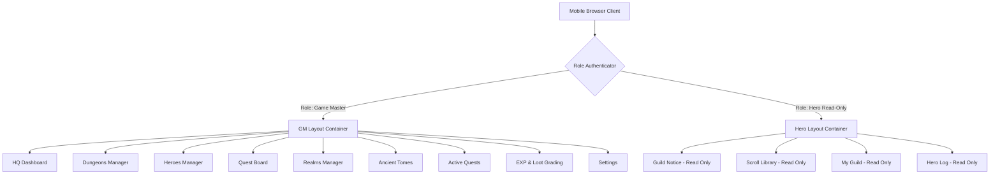

# Product Requirement Document (PRD)

## Pixel Quest Academy — Retro 8-Bit Mobile LMS

---

### 1. Meta Information & Versioning

* **Document Title:** Pixel Quest Academy — PRD
* **Version:** 2.0.0
* **Date:** 12 November 2026
* **Status:** Approved / Ready for Production
* **Author:** Product & Architecture Team
* **Target Audience:** Frontend Engineers, UI/UX Designers, Gamification Specialists, Educational Content Developers

---

### 2. Executive Summary & Product Vision

**Pixel Quest Academy** adalah platform *Learning Management System* (LMS) berbasis web berpendekatan *mobile-first* yang dikemas dalam estetika **8-Bit Retro Arcade / RPG Game**. 

Aplikasi ini mengatasi kebosanan antarmuka LMS konvensional dengan menghadirkan atmosfer permainan konsol klasik. Dari sisi hak akses, aplikasi terbagi menjadi dua peran tegas:
1. **Game Master (Guru / Admin):** Memiliki kontrol penuh untuk mengelola kelas (*Dungeons*), siswa (*Heroes*), pengumuman (*Quest Board*), mata pelajaran (*Realms*), materi (*Ancient Tomes*), tugas (*Active Quests*), dan nilai (*EXP & Loot*).
2. **Hero (Siswa):** Mengakses aplikasi dalam mode **Read-Only** untuk membaca pengumuman (*Guild Notice*), membaca modul materi (*Scroll Library*), melihat kelas (*My Guild*), dan memantau perolehan nilai (*Hero Log / EXP & Stats*).

---

### 3. Retro 8-Bit Terminology Mapping Dictionary

Untuk menjaga kohesi tema game 8-bit, seluruh nama menu dan fungsi teknis dikonversi ke istilah RPG retro:

| Kategori Standard LMS | Terminologi Game Retro 8-Bit | Deskripsi & Hak Akses |
| :--- | :--- | :--- |
| **Guru / Admin** | **Game Master (GM) / Guild Master** | Pengelelola dunia pembelajaran (Full Access). |
| **Siswa** | **Hero / Adventurer** | Petualang akademis (Read-Only Access). |
| **GM Menu 1: Dashboard** | `🎮 HQ / Tavern Hall` | Overview statistik server, total hero aktif, dan aktivitas. |
| **GM Menu 2: Kelas** | `🏰 Dungeons / Guilds` | Pengelolaan rombel/kelas petualangan. |
| **GM Menu 3: Siswa** | `🧙‍♂️ Adventurers / Heroes` | Manajemen daftar akun siswa dan statistik hero. |
| **GM Menu 4: Pengumuman** | `📜 Quest Board / Broadcast` | Pembuatan bulletin dan pengumuman umum. |
| **GM Menu 5: Mapel** | `🗺️ Realms / Skill Trees` | Manajemen cabang Mata Pelajaran. |
| **GM Menu 6: Materi** | `📚 Ancient Tomes / Modul` | Publikasi modul teks & bahan bacaan. |
| **GM Menu 7: Tugas** | `⚔️ Active Quests` | Publikasi deskripsi quest & instruksi penugasan. |
| **GM Menu 8: Penilaian** | `🏆 EXP & Loot / Rapor` | Pengisian & penyuntingan nilai/EXP per Realm. |
| **GM Menu 9: Pengaturan** | `⚙️ System Settings` | Pengaturan preferensi sistem & profil GM. |
| **Hero Menu 1: Dashboard** | `📜 Guild Notice (Town Hub)` | Papan berita utama untuk membaca pengumuman (*Read-Only*). |
| **Hero Menu 2: Materi** | `📖 Scroll Library` | Perpustakaan modul bacaan per Realm (*Read-Only*). |
| **Hero Menu 3: Kelas** | `🏰 My Guild / Party` | Informasi ruang kelas & profil Game Master (*Read-Only*). |
| **Hero Menu 4: Nilai** | `⭐ Hero Log / EXP & Stats` | Papan rekap nilai/EXP sesuai Realm yang diikuti (*Read-Only*). |

---

### 4. Target Personas & User Segments

#### 4.1 Persona 1: Game Master (Pak Budi - Guru IPA)
* **Goal:** Ingin mempublikasikan materi dan tugas harian secara cepat tanpa terdistraksi pengaturan sistem yang rumit.
* **Needs:** Form input ringkas, navigasi jelas ke 9 menu utama, tabel input nilai yang responsif di perangkat mobile.

#### 4.2 Persona 2: Hero (Rian - Siswa Kelas X)
* **Goal:** Ingin memeriksa jadwal, pengumuman, modul bacaan, dan nilai dari smartphone kapan saja.
* **Needs:** Tampilan antarmuka retro 8-bit yang interaktif, kontras font yang mudah dibaca, navigasi yang intuitif tanpa risiko menekan tombol edit secara tidak sengaja.

---

### 5. Scope of Work

#### 5.1 In-Scope
* Implementation layout bertema **8-Bit Retro Arcade** menggunakan CSS Pixel Art Guidelines.
* Container aplikasi dikunci pada **Mobile Viewport** (lebar maksimum $480\text{px}$) dengan frame pembungkus berbentuk *Arcade Cabinet / Game Boy View* jika dibuka di desktop.
* Fitur Lengkap Role Game Master (9 Menu CRUD/Management).
* Fitur Lengkap Role Hero (4 Menu Read-Only View).
* Mock Data & Switching Role toggler untuk keperluan simulasi/demonstrasi.

#### 5.2 Out-of-Scope
* Fitur pengunggahan tugas oleh siswa (Siswa hanya membaca detail petunjuk tugas).
* Chat room real-time antar siswa.
* Payment gateway / fitur mikrotransaksi.

---

### 6. Functional Requirements & User Stories

#### 6.1 Role: Game Master (Full Access)

* **[US-GM-01] HQ Dashboard Overview**
  * *Requirement:* Menampilkan ringkasan total Hero terdaftar, jumlah Dungeons aktif, total Active Quests, dan status server.
* **[US-GM-02] Dungeons Management**
  * *Requirement:* CRUD data kelas (Nama Dungeon, Tingkat, Kode Guild, Kapasitas).
* **[US-GM-03] Heroes Roster Management**
  * *Requirement:* Menambah, mengubah, dan menghapus akun siswa serta melihat status keaktifan Hero.
* **[US-GM-04] Quest Board Broadcasting**
  * *Requirement:* Membuat pengumuman baru lengkap dengan judul, deskripsi, tingkat prioritas (*Low, Medium, Critical*), dan tanggal rilis.
* **[US-GM-05] Realms (Mapel) Configuration**
  * *Requirement:* Mengelola daftar mata pelajaran (misal: *Alchemic Chemistry, Arcane Mathematics, Nature Biology*).
* **[US-GM-06] Ancient Tomes Publishing**
  * *Requirement:* Mengunggah/menulis materi pembelajaran yang dikategorikan per Realm.
* **[US-GM-07] Active Quests Assignment**
  * *Requirement:* Membuat rincian instruksi tugas beserta *deadline* dan bobot EXP.
* **[US-GM-08] EXP & Loot Grading**
  * *Requirement:* Mengisi dan memperbarui nilai/skor siswa per Realm dan per Quest.
* **[US-GM-09] System Settings**
  * *Requirement:* Konfigurasi profil GM, tema warna 8-bit (NES Classic, Game Boy Green, Cyber Retro), dan reset data simulasi.

#### 6.2 Role: Hero / Siswa (Strict Read-Only)

* **[US-HR-01] Guild Notice Reading**
  * *Requirement:* Membaca feed pengumuman dari Game Master secara terurut berdasarkan waktu terbaru.
* **[US-HR-02] Scroll Library Browsing**
  * *Requirement:* Memilih Realm/Mapel dan membaca detail modul Ancient Tomes tanpa fitur penyuntingan.
* **[US-HR-03] My Guild Inspection**
  * *Requirement:* Melihat detail kelas yang terhubung dengan akun Hero, termasuk daftar anggota party dan nama Game Master pengampu.
* **[US-HR-04] Hero Log & EXP Tracker**
  * *Requirement:* Menampilkan rekapitulasi nilai (EXP Points, Grades, Rapor) yang dikelompokkan berdasarkan Realm secara transparan.

#### 6.3 Edge Cases & Handling Strategy

| Kode | Kasus Khusus (Edge Case) | Penanganan Sistem (Handling Strategy) |
| :--- | :--- | :--- |
| **EC-01** | Hero mencoba mengakses route GM (misal `/exp-loot/edit`) | System memblokir akses, menampilkan pesan 8-bit *"ACCESS DENIED! YOUR LEVEL IS TOO LOW!"*, dan mengarahkan kembali ke Town Hub. |
| **EC-02** | Modul materi/pengumuman kosong (*Empty State*) | Menampilkan ilustrasi pixel art peti harta kosong dengan teks *"No Scrolls Found in This Chest!"*. |
| **EC-03** | Penggunaan layar desktop | Layout $480\text{px}$ tetap berada di tengah layar (*centered*) dengan latar belakang Arcade Cabinet 8-bit. |

---

### 7. Technical Architecture & UI/UX Guidelines

#### 7.1 UI Specs & Palette
* **Font Specs:** Typography utama menggunakan Google Fonts `Press Start 2P` untuk judul/header, dan `VT323` atau `Silkscreen` untuk body text.
* **Color Palette (NES Style):**
  * Dark Slate (Background): `#1A1C2C`
  * Pixel Green (Accent/Success): `#38B764`
  * Arcade Red (Alert/Critical): `#EF7D57`
  * Retro Gold (EXP/Highlights): `#FEAE34`
  * Mana Blue (Active Navigation): `#3B5DC9`
* **Container Bounds:** Width diset presisi pada $360\text{px} \le \text{viewport} \le 480\text{px}$.

---

### 8. Non-Functional Requirements (NFRs)

* **Performance:** First Contentful Paint (FCP) $< 1.5\text{s}$ pada jaringan mobile 3G.
* **Security & Access Rules:** Enforce RBAC (*Role-Based Access Control*) pada level UI component rendering dan API endpoint validation.
* **UX Integrity:** $100\%$ komponen tombol dan form menggunakan style pixel border (`box-shadow` inset style atau custom pixel border SVGs).

---

### 9. Success Metrics & KPIs

* **Student Usability Score:** $> 90\%$ Hero dapat menemukan materi dan nilai tanpa bantuan teknis.
* **Mobile Viewport Compliance:** $100\%$ antarmuka terbebas dari *horizontal overflow scrolling* pada lebar layar $360\text{px} - 480\text{px}$.
* **Zero Edit Leakage:** $0\%$ bagian formulir edit atau hapus yang dapat diakses oleh akun Hero.
